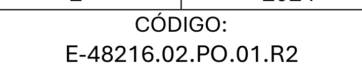
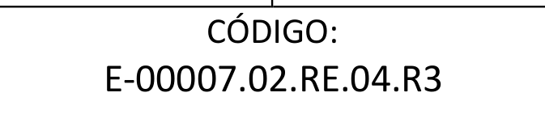
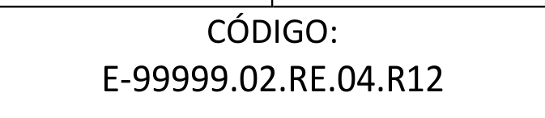
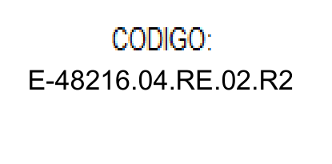
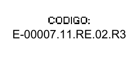
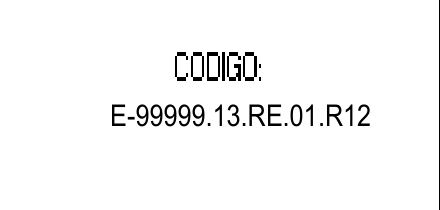

# Códigos completos y alineados

Recortes reales del motor de PDF, con estaciones ficticias. Se muestra solamente el cuadro de código; los documentos privados y los datos de personas no se publican.

El código se escribe completo en una sola línea: estación, identificador del procedimiento o registro y revisión. Se conserva el identificador original de cada formato. En los PDF con texto se conserva la fuente y la altura de la línea original; en los tres registros con encabezado incrustado en una imagen se sustituye solamente el texto del código.

## II — página física 12: procedimiento

## II — página física 33: registro de peligros y riesgos

## II — página física 34: continuación del registro

## IV — página física 13: programa de objetivos y metas

## XI — página física 15: programa de inspección

## XIII — página física 16: programa de simulacros

Las revisiones de dos cifras se muestran en las muestras II-34 y XIII-16. Si se cambia únicamente la estación, el código conserva su revisión original; una revisión específica tiene prioridad sobre la global para el procedimiento al que pertenece el identificador.

Se comprobó el contenido y la línea de base de los **512 códigos** calibrados en los 18 documentos. También se compararon los trazos de las tablas antes y después del llenado y los píxeles alrededor de los tres códigos incrustados en imágenes.

Prueba general: 78 pruebas ejecutadas sin fallos, con cinco grupos de plantillas antiguas omitidos. Incluye generación con los 18 PDF, conservación de estructura, portada II, firmas, listas vacías e interfaz.

Estos cambios corresponden al proyecto actualizado. El ZIP y el instalador v0.2.2 publicados anteriormente todavía contienen la versión anterior.

Reproducir localmente con la base privada: `python scripts/vistas_codigos.py RUTA_BASE_LIMPIA docs/codigos-corregidos`.
