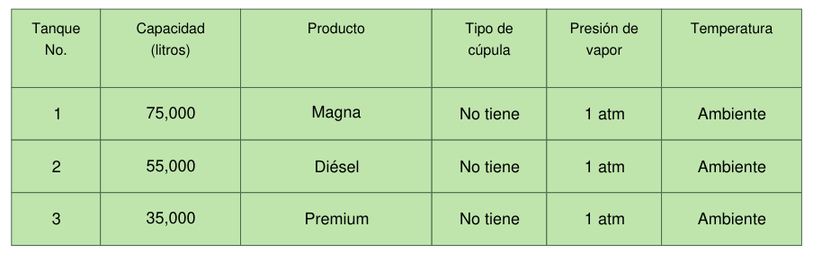
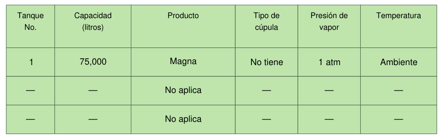
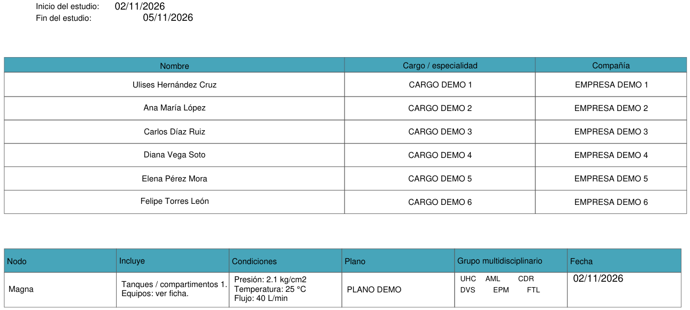
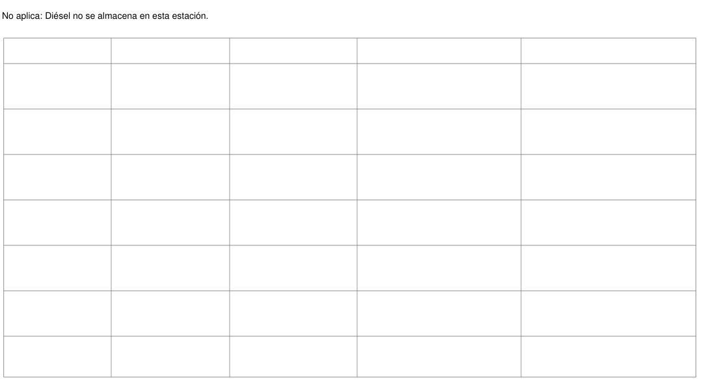
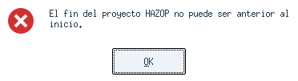

# Fotos de las nuevas pruebas

**Resultado:** se ejecutaron de nuevo 29 pruebas de HAZOP, equipo, fechas e instalaciones con la base PDF privada: todas terminaron sin fallos, sin omisiones. También se capturó un aviso real de validación en la aplicación de escritorio. En esta revisión no se detectaron fallos nuevos de funcionamiento.

Las imágenes 1 a 5 son vistas de **plantillas sintéticas con la geometría calibrada**, llenadas por el motor real con datos ficticios. Permiten mostrar los resultados sin publicar cuerpos de documentos privados. La imagen 6 es una **captura real del aviso de la aplicación**, usando una plantilla sintética.

## 1. Tres combustibles, con el orden cambiado

Resultado correcto: tanque 2 con Diésel y tanque 3 con Premium. Las capacidades son ficticias y diferentes de las de la base anterior. No se aprecian cruces de texto ni pérdida de bordes.

## 2. Estación que sólo almacena Magna

Resultado correcto: las filas restantes dicen «No aplica». No conservan litros o productos del ejemplo anterior.

## 3. Equipo, iniciales y fechas del proyecto

Los nombres, puestos y compañías provienen del perfil ficticio. Ulises Hernández Cruz aparece como **UHC** en el grupo. Las fechas de inicio y fin son independientes; la fecha del nodo usa el inicio porque no se capturó otra sesión.

## 4. Apartado HAZOP de Diésel cuando no existe

Se borraron los datos de demostración y quedó «No aplica: Diésel no se almacena en esta estación». La cuadrícula se conserva. No se insertan iniciales ni fechas en ese apartado. No se está calculando una matriz de riesgo nueva.

## 5. Problema provocado: información incompleta

Se quitaron deliberadamente la empresa del líder y la presión de operación. **Hay datos que completar:** el resultado muestra «Pendiente», en lugar de inventarlos o copiar valores anteriores.

Esto no bloquea automáticamente la exportación: el programa permite perfiles parciales. El documento debe revisarse y completarse antes de utilizarlo.

## 6. Problema provocado: fin anterior al inicio

Se capturó inicio **02/11/2026** y fin **01/11/2026** y se pulsó Generar PDF. La aplicación mostró el aviso y **no creó la carpeta de salida**. Es el rechazo esperado de datos contradictorios, no un cierre inesperado del programa.

Reproducir las imágenes en un escritorio disponible: `python scripts/fotos_pruebas_hazop.py docs/fotos-pruebas-hazop`. Las pruebas de PDF reales requieren la base privada; ésta no se incluye en el repositorio público.

Estas imágenes corresponden al proyecto actualizado. El ZIP público v0.2.2 todavía contiene la versión anterior.
