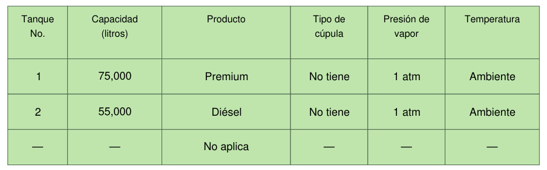
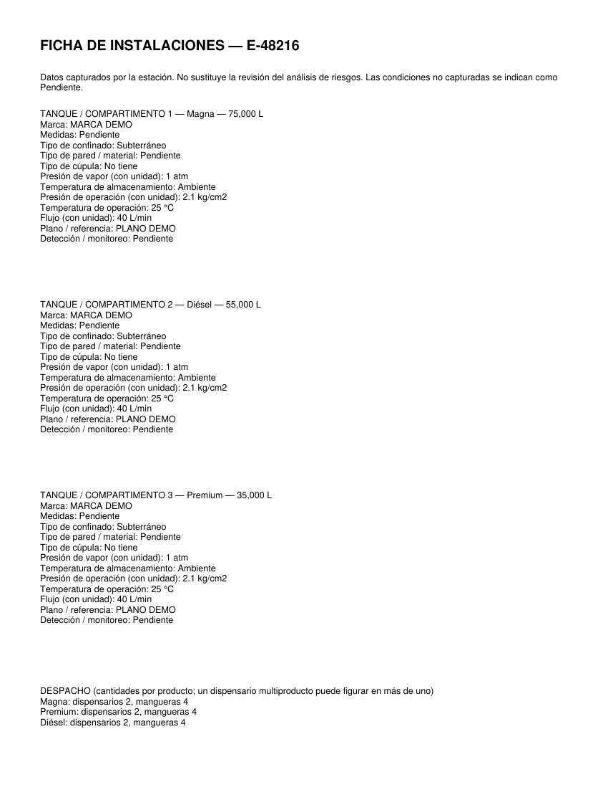

# Tanques y combustibles por estación

En **Instalaciones** se captura cada tanque o compartimento una sola vez y se activa **Aplicar datos de instalaciones a los documentos**. Los perfiles anteriores siguen funcionando sin activar esta opción. Guardar y cargar datos conserva el inventario y las cantidades de despacho.

La ficha admite número o identificador, producto, litros, marca, medidas, confinado, material o pared, cúpula, presión de vapor, temperatura de almacenamiento, presión y temperatura de operación, flujo, plano y detección o monitoreo. También permite cantidades de dispensarios y mangueras por producto; un dispensario multiproducto puede figurar en más de un producto y esas cantidades no se suman como equipos únicos.

No se supone que el tanque 2 siempre es Premium: se vincula por el producto y el número capturados. Puede haber varios tanques del mismo producto. Si sus condiciones difieren, el nodo remite a la ficha detallada en lugar de mostrar un único valor incorrecto.

## Dónde se refleja

Se revisaron los 18 PDF de la base. Las repeticiones específicas del inventario se concentran en estos lugares; las páginas indicadas son las físicas del archivo original:

| Documento | Páginas | Actualización |
| --- | --- | --- |
| II | 29 | Productos en el diagrama de recepción. |
| II | 30 | Descripción del almacenamiento, tabla de tanques y productos de despacho. Se retiran las afirmaciones anteriores sobre marca, capacidades, materiales y detección de ese bloque. |
| II | 33–34 | Tanques incluidos en cada nodo y sus condiciones de operación y planos. |
| II | 34–54 | Presión, temperatura, flujo y plano en las descripciones HAZOP. Apartados de combustibles ausentes: «No aplica», conservando trazos de tablas, encabezados y cuadros de firmas. |
| II | 55–57 | Productos aplicables en las columnas del catálogo de escenarios. |
| III | 25 | La consecuencia genérica de derrame deja de afirmar la presencia de Diésel cuando no se almacena. |
| XIII | 33, 40 | Materiales peligrosos y productos de los nodos de estudio. |
| XIII | 35–36 | Descripción del almacenamiento, tabla de tanques y productos de despacho. |
| II y XIII | Fichas anexas | Inventario completo, todos los datos técnicos y cantidades de dispensarios y mangueras. |

Las dos tablas originales mantienen sus tres filas y bordes. Las filas no utilizadas indican «No aplica». Con más de tres tanques, las primeras tres filas muestran los primeros tres y la descripción remite al inventario completo anexo. Se admiten hasta 60 tanques o compartimentos, con fichas adicionales de tres por página. Las fichas también pueden verse al final del documento en la vista previa.

Un producto sin tanque no se presenta como existente. Los datos no capturados dicen **Pendiente**: no se copian la marca, los litros ni las condiciones del ejemplo. La presión de vapor y la presión de operación son campos distintos. No se sustituyen capacidades de autotanques proveedores por capacidades de almacenamiento, ni se cambian los nombres de normas que mencionan gasolinas y diésel.

El archivo de requisitos se utilizó como referencia de campos. Se detectaron diferencias respecto de las plantillas en el orden de productos y la marca de tanques, además de un renglón de número de estación que contiene una razón social. No se importaron automáticamente sus datos personales ni se impusieron sus notas como reglas del programa.

**El sistema actualiza datos, no recalcula la valoración HAZOP ni certifica el análisis de riesgos.** Al generar un lote con instalaciones se incluye ese aviso en el informe. Las matrices de los productos presentes necesitan revisión técnica cuando cambian las condiciones de la estación.

## Imágenes de demostración

Estas tablas se reconstruyeron sobre una plantilla sintética y se llenaron con el motor real. Todos los datos son ficticios; no se publican páginas privadas.

Tres productos con Diésel en el tanque 2 y Premium en el 3:

Sólo Magna:

Premium y Diésel, sin Magna:

Ficha detallada que agrega el programa:

Reproducir las imágenes: `python scripts/vistas_instalaciones.py docs/instalaciones`.

Esta función está incorporada al proyecto. **El ZIP y el instalador v0.2.2 publicados anteriormente todavía no la incluyen.**

## Verificación

La suite completa terminó con 88 pruebas sin fallos y cinco omisiones de plantillas retiradas. Se probaron tres combinaciones de combustibles, cambio de orden de tanques, varios tanques del mismo producto, cuatro tanques con continuación, persistencia de perfiles, vista previa de anexos y conservación de bordes y cuadros de firmas.

Además se generó un lote real de los 18 PDF con datos ficticios. El unido contiene 525 páginas: las 523 originales y una ficha en II y otra en XIII, con 18 marcadores. En los dos documentos vinculados se comprobó que no quedaran las capacidades, la marca ni las condiciones de operación del ejemplo anterior. La validación de datos numéricos también se comprobó después del último ajuste.
