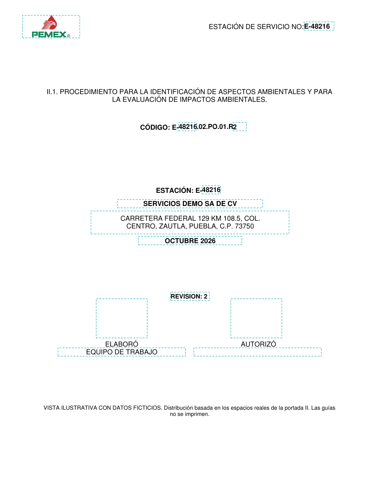
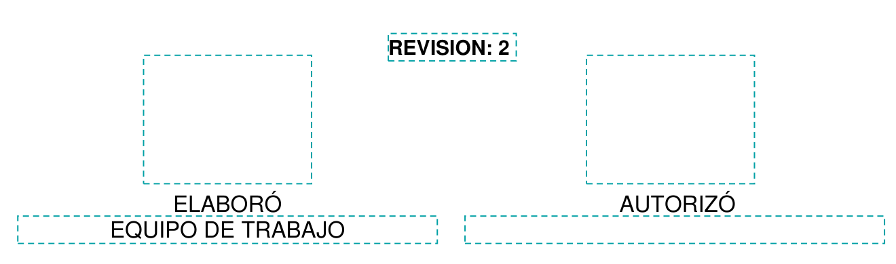
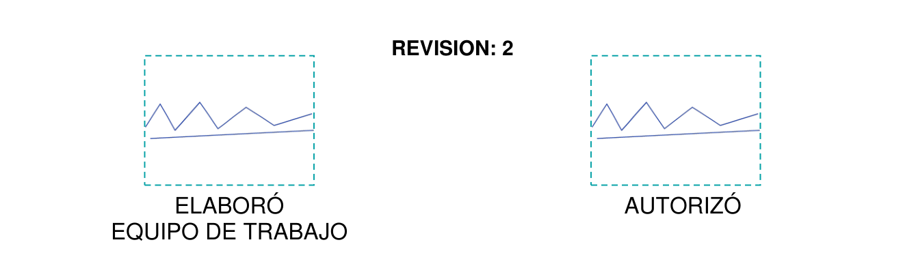

# Portada II: primeras dos imágenes revisadas

Cambios aplicados en el proyecto a la **primera portada del procedimiento II**:

- Dirección centrada, con renglones equilibrados, conservando el tamaño original cuando el texto cabe. El bloque queda separado de la razón social y de la fecha.
- Área editable de ELABORÓ con el mismo ancho y alto que la de AUTORIZÓ: **82.5 × 63.25 puntos**. Ambas tienen el mismo borde superior e inferior; la izquierda queda centrada sobre ELABORÓ. La derecha conserva su tamaño y posición.
- Número de estación superior escrito completo como `E-00000`, para no conservar una E sin guion ni duplicar el prefijo original.

Esta revisión se limita a esa portada. Los encabezados interiores y los demás registros siguen pendientes de su revisión por imagen.

## Portada con campos visibles

## Los dos espacios editables iguales

## Ejemplo con firmas simuladas

Las imágenes públicas son ilustraciones con datos ficticios y los espacios reales del mapa del programa. No publican el PDF privado. Las firmas son trazos simulados y las guías azules solo explican las áreas editables.

Se comprobó además el renderizado de la portada PDF real: tamaño de letra, prefijo `E-`, firmas dentro de sus zonas y conservación de rótulos y trazos del formato. Pasaron también las pruebas de interfaz tras iniciar la pantalla virtual del entorno de desarrollo.

[Ver medidas y resultados de la vista](portada-ii-revisada/resultados.json).

**Estos cambios aún no están en el ZIP de instalación anterior.** Están aplicados al proyecto para la entrega actualizada, después de la revisión de imágenes.
