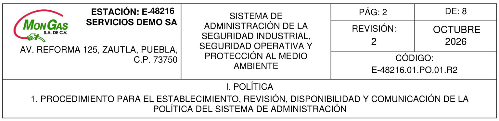
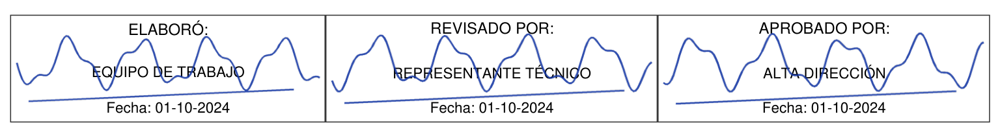
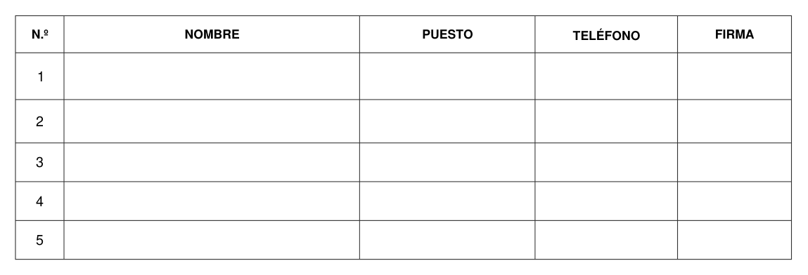

# Prueba con una estación ficticia

Se eligió el logo de **MonGas**, aportado por el usuario. El domicilio, las personas y las firmas se inventaron para esta prueba; no representan una estación real de la marca.

| Dato | Valor de prueba |
| --- | --- |
| Estación | E-48216 |
| Razón social | SERVICIOS DEMO SA |
| Dirección | AV. REFORMA 125, ZAUTLA, PUEBLA, C.P. 73750 |
| Revisión | 2 |
| Fecha de revisión | 16/10/2026 |
| Elaboración | Carlos Medina |
| Responsable de revisión | Elena Torres |
| Aprobación | Javier Ruiz |

Las personas están asignadas en el perfil. **Sus nombres no se imprimen en los cuadros del pie:** allí aparecen únicamente sus firmas simuladas en azul. Las fechas fijas de esos cuadros se conservan como en el formato.

## Encabezado

Logo proporcionado, número de estación, razón social, dirección alineada a la derecha y datos de revisión.

## Firmas dentro de los cuadros

Se amplían sin deformarse, pueden tocar las letras y no borran los textos ni las líneas. Los trazos son simulados para la demostración y no pertenecen a personas reales.

## Asistencia vacía

Sin nombres, puestos, teléfonos ni firmas. Se mantienen las filas y la numeración.

[Ver una página ilustrativa completa](prueba-estacion-completa/01-documento-completo.png)

Las imágenes públicas utilizan una plantilla de demostración con el motor real y las reglas del programa. Los PDF originales del usuario se mantienen fuera del repositorio público.

La prueba sobre los PDF del usuario generó **18 procedimientos, 523 páginas y un PDF unido con 18 marcadores**. Se comprobaron 1,197 firmas dentro de sus cuadros y 33 filas de asistencia vacías. También se comprobaron las dimensiones de las páginas y los trazos originales de las tablas.

El entorno emitió dos avisos de sustitución de fuentes por Helvetica/Helvetica-Bold para caracteres ausentes en la fuente original. Conviene revisar esos textos en Windows; no se afirma que todas las fuentes sean idénticas al original.

[Consultar los resultados de la prueba](prueba-estacion-completa/resultados.json)

Durante la prueba, domicilios más largos excedieron espacios existentes de una carta del procedimiento V y una página del XI. El motor detuvo esos intentos sin recortar el texto ni entregar un lote incompleto. Para esos domicilios habrá que ajustar las ubicaciones; el ejemplo final utiliza el domicilio breve indicado arriba.

Reproducir las vistas: `python scripts/prueba_estacion_completa.py docs/prueba-estacion-completa`.
