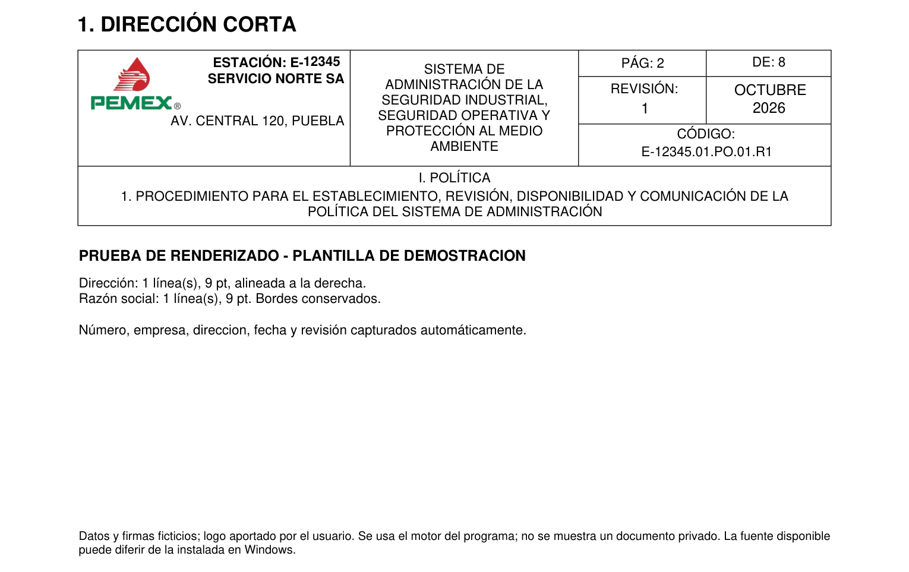
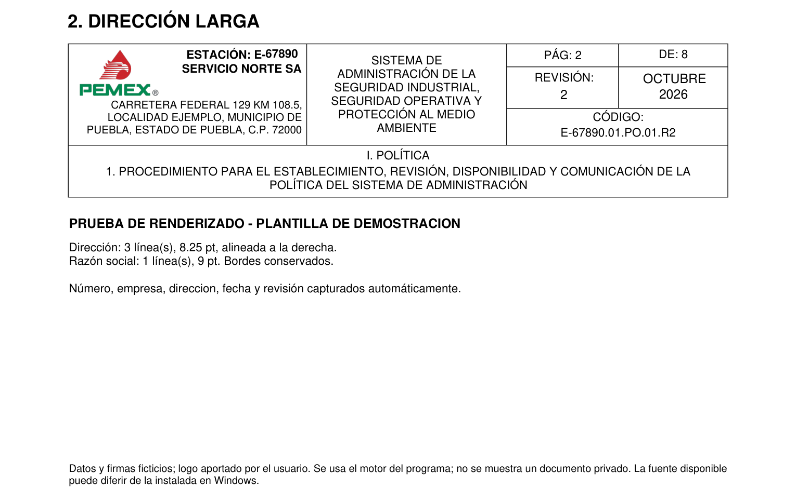
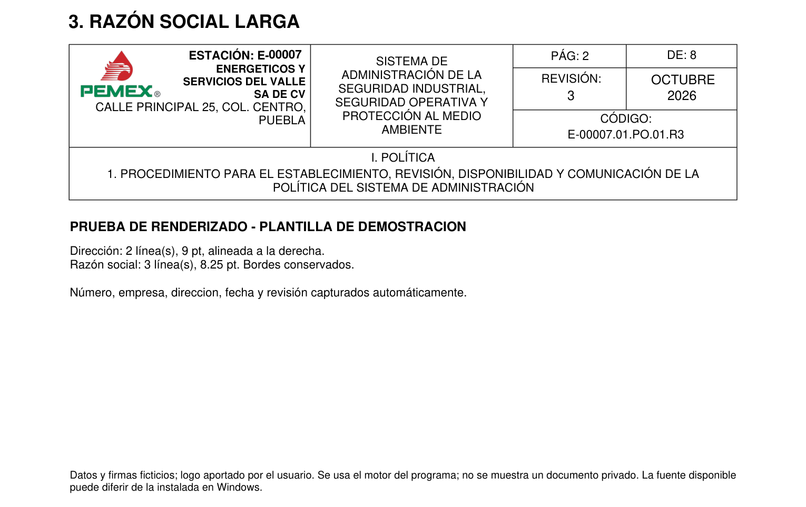
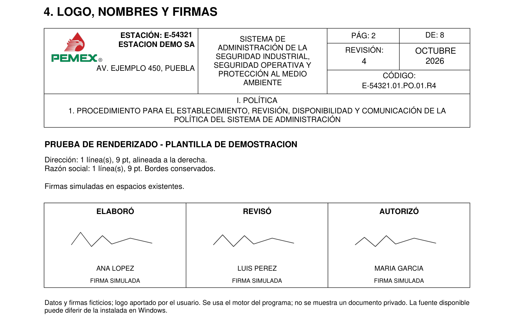

# Cuatro pruebas visuales del llenado

Ejemplos generados con el motor PDF del programa sobre una plantilla de demostración. Los datos y las firmas son ficticios. Se usa el logo PEMEX aportado por el usuario, preparado como PNG transparente. Las páginas se renderizan con el motor PDF y no muestran documentos privados. Las fuentes disponibles aquí pueden diferir de las instaladas en Windows.

[Ver las cuatro pruebas juntas](pruebas-visuales/00-todas-las-pruebas.png)

## 1. Dirección corta

Una línea a 9 puntos, alineada a la derecha y situada al inicio de su bloque.



## 2. Dirección larga

Tres líneas a 8.25 puntos, alineadas a la derecha, dentro de su espacio.



## 3. Razón social larga

Empresa en tres líneas a 8.25 puntos, con separación respecto al número de estación; dirección en dos líneas. También se conserva el cero inicial del número E-00007.



## 4. Logo, nombres y firmas

Logo PEMEX proporcional, tres nombres distintos y firmas simuladas en las casillas de la plantilla de demostración. No son firmas de personas reales.



Los ejemplos tienen códigos continuos, acentos y un margen interior mayor en el título inferior. Se verificó que los trazos de las tablas permanecieran iguales antes y después del llenado. Los tamaños y líneas resultantes están en [resultados.json](pruebas-visuales/resultados.json).

Para reproducir estas imágenes sin PDF privados:

```sh
python scripts/ejemplos_visuales.py docs/pruebas-visuales
```
