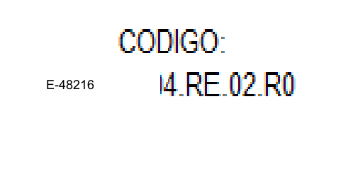
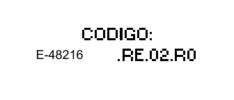
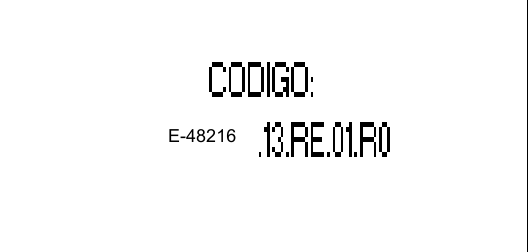
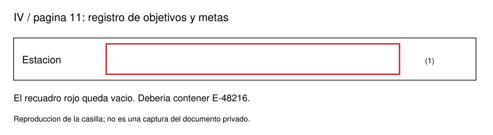

# Errores en el número de estación de los registros

**Actualización:** los problemas de los cuadros de código se corrigieron en el proyecto. [Ver las imágenes del resultado](codigos-corregidos.md). Esta página conserva el diagnóstico anterior. La casilla interior «Estación (1)» es un pendiente distinto.

Estos recortes provienen de los PDF generados con la estación **ficticia E-48216**, no de una ilustración del programa. Se muestran únicamente los cuadros de código: no se publican cuerpos de documentos privados ni datos de personas.

La revisión encontró problemas que las pruebas anteriores de integridad y de presencia del número no detectaron. Que aparezcan los cinco dígitos no basta para validar la apariencia ni el código completo.

## IV. Programa de gestión de objetivos y metas — página física 13

El número se inserta con tamaño de 3 puntos, separado del resto del código. El área de borrado también afecta al comienzo del sufijo impreso.

El código debe ser continuo: `E-48216.04.RE.02.R…`, con la revisión que corresponda al documento.

## XI. Programa de inspección de equipos críticos — página física 15

El número queda separado y el código pierde el tramo `11` que identifica el procedimiento.

Debe ser continuo: `E-48216.11.RE.02.R…`.

## XIII. Programa de simulacros — página física 16

El número tiene tamaño y aspecto distintos del sufijo porque se escribe como un fragmento independiente sobre un encabezado incrustado en una imagen.

Debe ser continuo: `E-48216.13.RE.01.R…`.

En estos tres ejemplos también permanece `R0` en la imagen, aunque el perfil de prueba utiliza revisión 2. Esa parte del código necesita contemplarse al corregir el bloque completo.

## IV. Registro de objetivos, metas e indicadores — página física 11

El encabezado recibe la estación, pero la casilla interior **Estación (1)** queda vacía porque no tiene una ubicación automática asignada. La siguiente imagen reproduce esa casilla; no publica el cuerpo del PDF privado.

## Alcance

Se revisó la presencia de los dígitos de prueba en las 1,510 ubicaciones de estación ya mapeadas. Eso no detecta campos que todavía no tienen ubicación, textos rasterizados dañados ni tamaños desiguales. Los ejemplos anteriores son fallos confirmados; no significan que cada uno de los demás registros esté validado visualmente.

Esta página conserva el diagnóstico previo a la corrección. El instalador descargable v0.2.2 todavía contiene la versión anterior.
