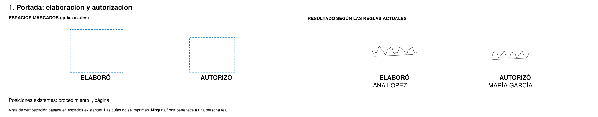
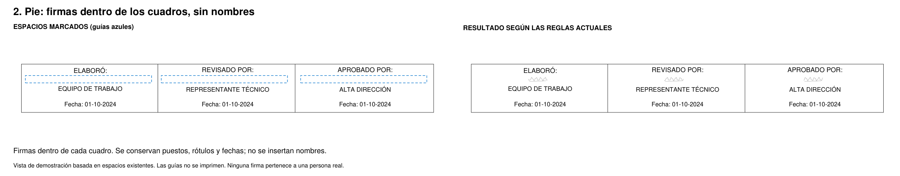
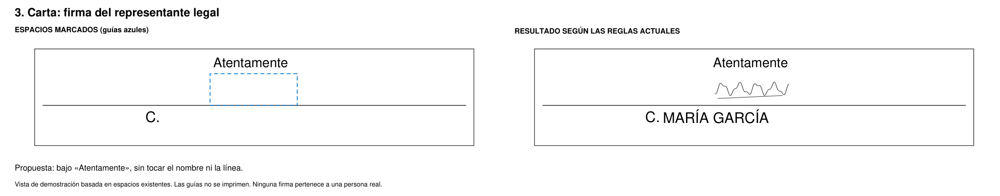
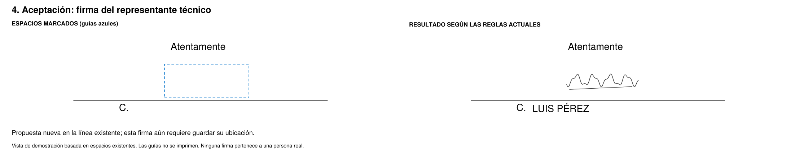
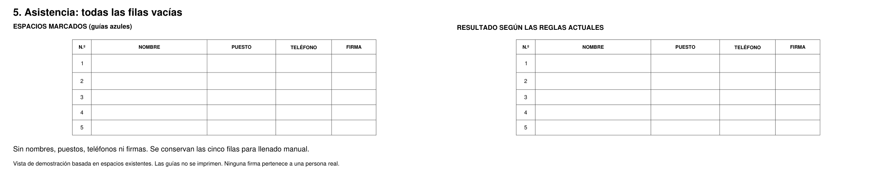

# Dónde irían las firmas

[Ver las cinco vistas juntas](firmas-propuesta/00-todas-las-firmas.png)

Cada imagen muestra **el espacio marcado a la izquierda** y **el resultado a la derecha**. Las guías azules sirven para explicar la posición y no forman parte del documento final.

Son vistas de demostración basadas en la geometría de los espacios existentes. No se muestran documentos privados ni firmas reales. Las posiciones señaladas como propuestas todavía no se han aplicado a las reglas del programa.

## 1. Portada: elaboración y autorización

Dos espacios existentes, uno para quien elabora y otro para quien autoriza. La firma queda arriba del rótulo y del nombre, conservando su proporción.

## 2. Pie de página: elaboración, revisión y aprobación

Las firmas quedan dentro de cada cuadro, sin nombres de personas. Se conservan los rótulos, puestos y fechas originales. La firma se ajusta proporcionalmente al espacio disponible.

## 3. Carta del representante legal

Se propone dejar la firma debajo de «Atentamente» y encima de la línea, sin tocar el nombre ni las letras impresas.

## 4. Carta de aceptación del representante técnico

La carta ya tiene una línea para firmar. Se muestra una propuesta en ese espacio; **esta firma aún requiere guardar su ubicación automática**. No se agrega otro bloque de firma.

## 5. Lista de asistencia

Todas las filas se entregan vacías: sin nombres, puestos, teléfonos ni firmas. Se conservan las columnas, la numeración y las filas originales para llenarlas manualmente. Los datos de perfiles anteriores tampoco se insertan.

Las imágenes se colocaron con el motor del programa. Se comprobó que cada firma quedara dentro de su región y que se conservaran los trazos de las tablas. Las fuentes disponibles aquí pueden variar respecto de Windows.

[Ver resultados](firmas-propuesta/resultados.json)

Reproducir: `python scripts/vistas_firmas.py docs/firmas-propuesta`.
