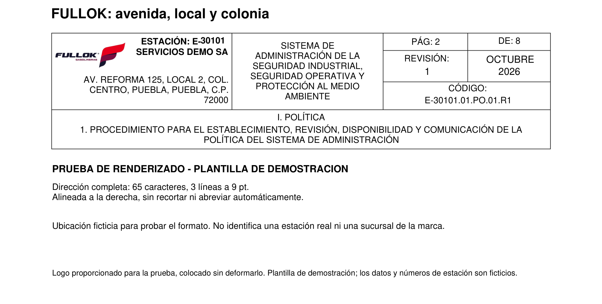
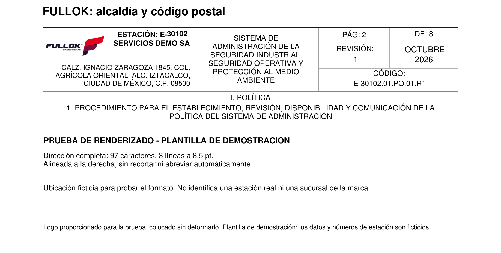
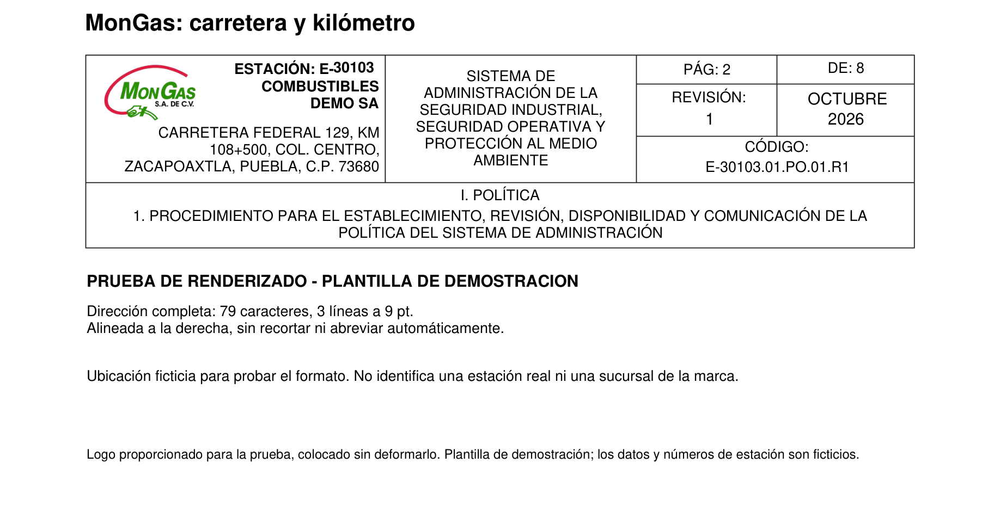
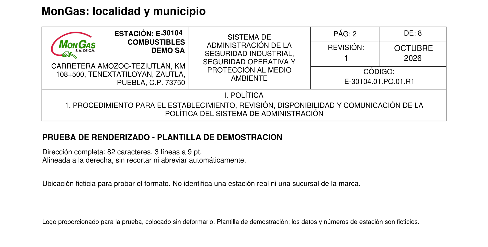
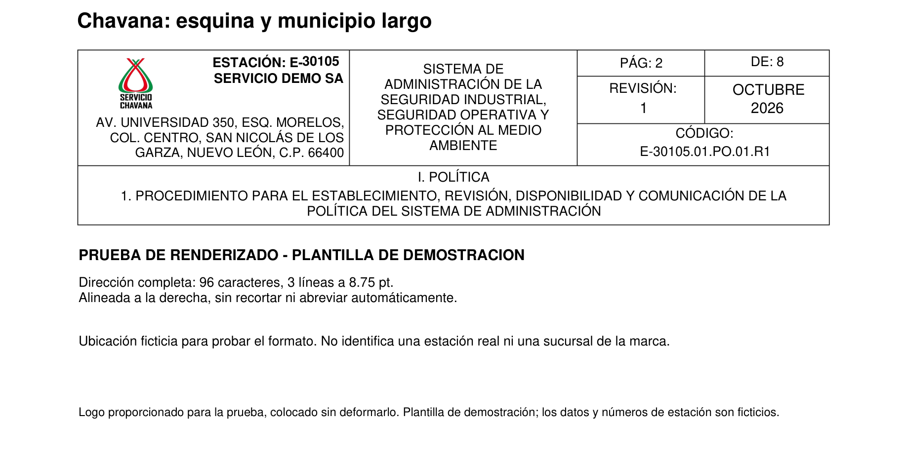
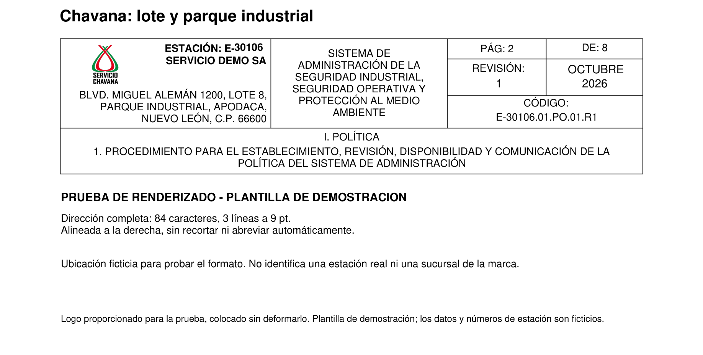
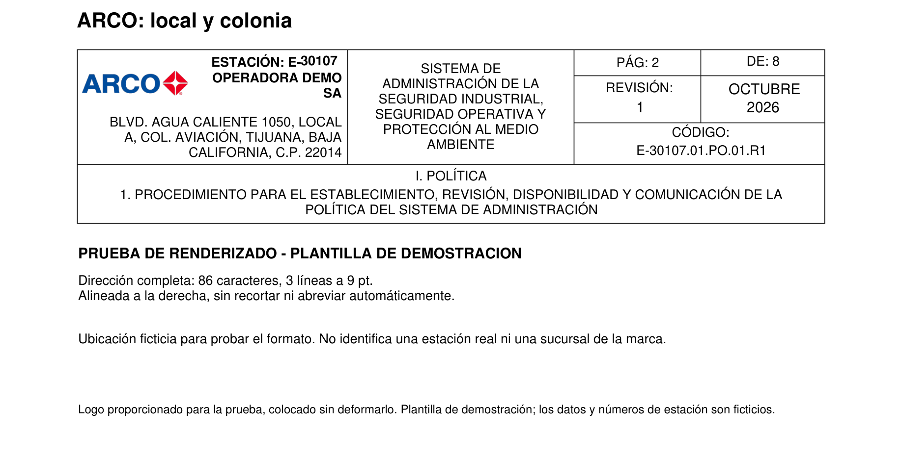
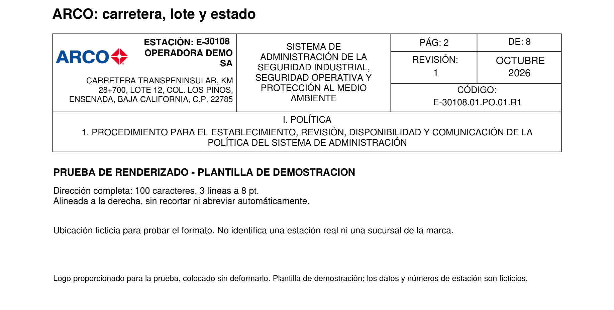
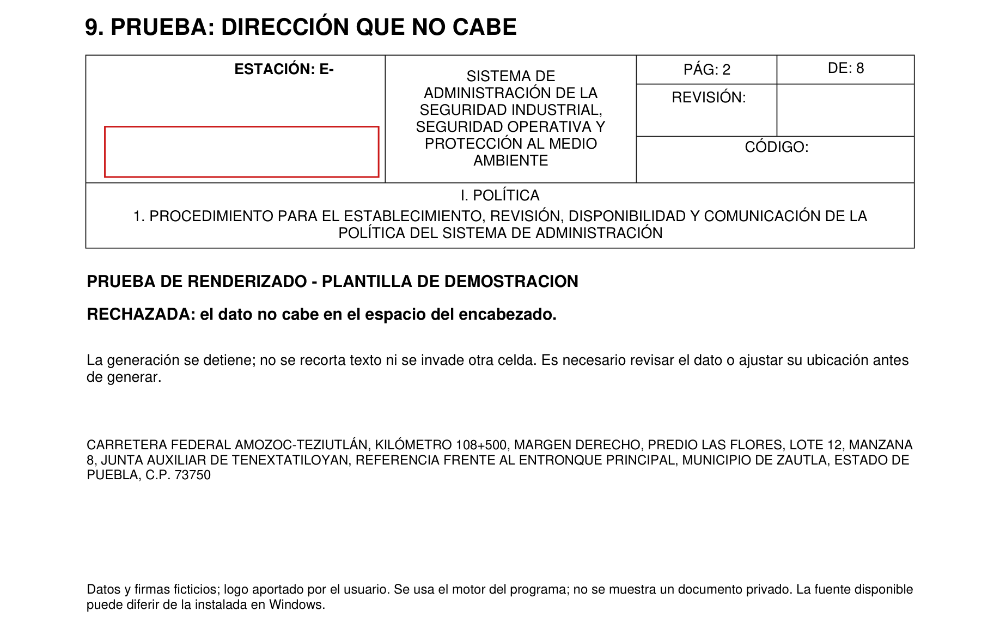

# Pruebas con direcciones específicas y cuatro logos

Ocho ejemplos generados con el motor PDF sobre la plantilla de demostración. Los logos se prepararon a partir de las imágenes proporcionadas. **Las direcciones, empresas y números de estación son datos ficticios para probar el formato; no identifican sucursales reales.** Las fuentes pueden variar respecto de Windows.

[Ver las ocho imágenes juntas](ubicaciones-detalladas/00-todas-las-ubicaciones.png)

| Prueba | Caracteres | Líneas | Tamaño |
|---|---:|---:|---:|
| [FULLOK: avenida, local y colonia](ubicaciones-detalladas/01-fullok-avenida.png) | 65 | 3 | 9 pt |
| [FULLOK: alcaldía y código postal](ubicaciones-detalladas/02-fullok-alcaldia.png) | 97 | 3 | 8.5 pt |
| [MonGas: carretera y kilómetro](ubicaciones-detalladas/03-mongas-kilometro.png) | 79 | 3 | 9 pt |
| [MonGas: localidad y municipio](ubicaciones-detalladas/04-mongas-localidad.png) | 82 | 3 | 9 pt |
| [Chavana: esquina y municipio largo](ubicaciones-detalladas/05-chavana-esquina.png) | 96 | 3 | 8.75 pt |
| [Chavana: lote y parque industrial](ubicaciones-detalladas/06-chavana-industrial.png) | 84 | 3 | 9 pt |
| [ARCO: local y colonia](ubicaciones-detalladas/07-arco-local.png) | 86 | 3 | 9 pt |
| [ARCO: carretera, lote y estado](ubicaciones-detalladas/08-arco-carretera.png) | 100 | 3 | 8 pt |

Las ocho direcciones quedaron completas y alineadas a la derecha. Se comprobaron los bordes y la proporción de las imágenes. El logo vertical de Chavana se ve más pequeño que los horizontales dentro de la misma casilla. En algunos saltos de línea el código postal queda al final por separado: estas imágenes permiten revisar ese detalle visual.

## 1. FULLOK: avenida, local y colonia

AV. REFORMA 125, LOCAL 2, COL. CENTRO, PUEBLA, PUEBLA, C.P. 72000

## 2. FULLOK: alcaldía y código postal

CALZ. IGNACIO ZARAGOZA 1845, COL. AGRÍCOLA ORIENTAL, ALC. IZTACALCO, CIUDAD DE MÉXICO, C.P. 08500

## 3. MonGas: carretera y kilómetro

CARRETERA FEDERAL 129, KM 108+500, COL. CENTRO, ZACAPOAXTLA, PUEBLA, C.P. 73680

## 4. MonGas: localidad y municipio

CARRETERA AMOZOC-TEZIUTLÁN, KM 108+500, TENEXTATILOYAN, ZAUTLA, PUEBLA, C.P. 73750

## 5. Chavana: esquina y municipio largo

AV. UNIVERSIDAD 350, ESQ. MORELOS, COL. CENTRO, SAN NICOLÁS DE LOS GARZA, NUEVO LEÓN, C.P. 66400

## 6. Chavana: lote y parque industrial

BLVD. MIGUEL ALEMÁN 1200, LOTE 8, PARQUE INDUSTRIAL, APODACA, NUEVO LEÓN, C.P. 66600

## 7. ARCO: local y colonia

BLVD. AGUA CALIENTE 1050, LOCAL A, COL. AVIACIÓN, TIJUANA, BAJA CALIFORNIA, C.P. 22014

## 8. ARCO: carretera, lote y estado

CARRETERA TRANSPENINSULAR, KM 28+700, LOTE 12, COL. LOS PINOS, ENSENADA, BAJA CALIFORNIA, C.P. 22785

## 9. Una dirección que supera el espacio

La prueba extrema tiene 235 caracteres y no cabe con el mínimo de 8 puntos. El motor la rechaza antes de modificar la página. No corta palabras ni reduce el texto por debajo del límite. La imagen muestra una representación de ese rechazo sobre la plantilla de demostración.

[Ver resultados comprobados](ubicaciones-detalladas/resultados.json)

Reproducir: `python scripts/ubicaciones_detalladas.py docs/ubicaciones-detalladas`.
